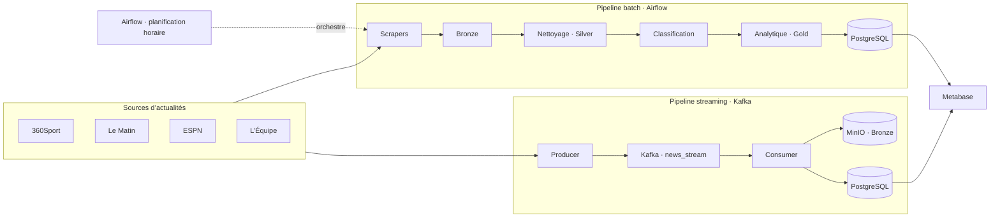
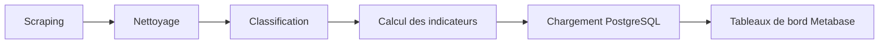

<div align="center">

# Sports Data Platform

### Plateforme de collecte, de traitement et d’analyse d’actualités sportives

**Scraping · Kafka · MinIO · Airflow · PostgreSQL · Metabase**

[Architecture](#-architecture) · [Démarrage](#-démarrage-rapide) · [Pipeline](#-pipelines-de-données) · [Structure](#-structure-du-projet)

</div>

---

## Présentation

**Sports Data Platform** est un projet d’ingénierie des données de bout en bout consacré aux actualités sportives. Il collecte des articles depuis plusieurs médias, les transforme en données exploitables, puis les rend disponibles pour l’analyse et la visualisation.

Le dépôt propose deux modes complémentaires :

- **Batch** : traitement orchestré par Airflow, depuis la collecte jusqu’au chargement analytique.
- **Streaming** : détection périodique de nouveaux articles, transmission par Kafka et écriture dans MinIO et PostgreSQL.

> Les sources, la disponibilité des articles et les résultats de collecte dépendent des sites consultés.

## Fonctionnalités

| Fonctionnalité | Description |
| --- | --- |
| Collecte multi-sources | Scrapers pour 360Sport, Le Matin, ESPN et L’Équipe |
| Deux modes d’ingestion | Pipeline batch et flux Kafka |
| Architecture médaillon | Données organisées en couches Bronze, Silver et Gold |
| Préparation des données | Nettoyage, normalisation, déduplication et contrôles qualité |
| Classification sportive | Catégories contrôlées : football, tennis, basketball et other |
| Analytique | Statistiques par date, source et catégorie, ainsi que mots fréquents |
| Orchestration | DAG Airflow planifié toutes les heures |
| Visualisation | PostgreSQL comme entrepôt et Metabase pour les tableaux de bord |

## Architecture



### Couches de données

| Couche | Rôle | Exemple de sortie |
| --- | --- | --- |
| **Bronze** | Conserver les articles collectés au format brut | `data/bronze/` et bucket MinIO `bronze` |
| **Silver** | Nettoyer, normaliser, dédupliquer et valider les articles | `articles_clean.json`, `articles_classified.json` |
| **Gold** | Préparer les agrégats destinés à l’analyse | `articles_stats.json`, `top_words.json` |

### Étapes du pipeline batch



Airflow exécute les étapes dans cet ordre : `scraping_task` → `cleaning_task` → `classification_task` → `gold_task` → `load_to_db`.

## Technologies

| Domaine | Technologies |
| --- | --- |
| Langage | Python |
| Collecte et traitement | Requests, BeautifulSoup, pandas |
| Streaming | Apache Kafka, kafka-python |
| Stockage objet | MinIO, client S3 `boto3` |
| Orchestration | Apache Airflow |
| Entrepôt de données | PostgreSQL |
| Visualisation | Metabase |
| Environnement local | Docker Compose |

## Structure du projet

```text
.
├── airflow/                 # DAGs et configuration Airflow
│   └── dags/pipeline_dag.py
├── dashboard/               # Guide et documentation du dashboard
├── data/                    # Données locales Bronze / Silver / Gold
├── ingestion/               # Entrées batch et Kafka
├── processing/              # Nettoyage, classification et analytics
├── scrapers/                 # Collecteurs par source
├── warehouse/               # Schéma SQL et chargement PostgreSQL
├── docker-compose.yml       # Services de la plateforme
├── Dockerfile
├── requirements.txt
├── start.sh / start.bat     # Scripts de démarrage
└── README.md
```

## Démarrage rapide

### Prérequis

- Docker et Docker Compose
- Git
- Python 3.11+ uniquement si vous exécutez les scripts Python directement sur l’hôte

### 1. Récupérer le projet

```bash
git clone https://github.com/Hiba-Benyassine/AD-Project.git
cd AD-Project
```

### 2. Démarrer les services

**Linux / macOS / Git Bash**

```bash
chmod +x start.sh
./start.sh
```

**Windows**

```bat
start.bat
```

Ou, sans script de démarrage :

```bash
docker compose up -d
```

Le premier démarrage peut prendre quelques minutes, le temps que les conteneurs s’initialisent.

### 3. Initialiser le schéma PostgreSQL

```bash
docker compose exec -T postgres psql -U sports_user -d sports_warehouse < warehouse/schema.sql
```

### 4. Ouvrir les interfaces

| Service | Adresse | Identifiants initiaux / remarques |
| --- | --- | --- |
| Airflow | [http://localhost:8080](http://localhost:8080) | `admin` / `admin` |
| MinIO Console | [http://localhost:9001](http://localhost:9001) | `minioadmin` / `minioadmin` |
| Metabase | [http://localhost:3000](http://localhost:3000) | Suivre l’assistant de première configuration |
| PostgreSQL | `localhost:5432` | Base `sports_warehouse`, utilisateur `sports_user` |
| Kafka | `localhost:9092` | Broker exposé pour les clients depuis l’hôte |

> Ces identifiants sont des valeurs de développement définies dans `docker-compose.yml`. Ne les réutilisez pas dans un environnement exposé ou de production.

Les buckets MinIO `bronze`, `silver` et `gold` sont créés par le service `minio_init`.

## Pipelines de données

### Batch avec Airflow

Le DAG `sports_data_pipeline` est planifié toutes les heures. Il est créé en pause à l’initialisation : ouvrez Airflow et activez-le si vous souhaitez lancer les exécutions planifiées.

Pour exécuter manuellement les traitements depuis l’environnement Python local, installez les dépendances puis lancez les étapes dans l’ordre :

```bash
pip install -r requirements.txt
python ingestion/batch_pipeline.py
python processing/cleaning.py
python processing/classification.py
python processing/gold_analytics.py
python warehouse/load_to_postgres.py
```

### Streaming avec Kafka

Le service producer vérifie périodiquement les sources (cycle de 60 secondes), publie les nouveaux articles sur le topic `news_stream`, puis le consumer les enregistre dans MinIO et PostgreSQL.

Les services Kafka, producer et consumer sont définis dans `docker-compose.yml` et démarrent avec `docker compose up -d`. Pour consulter leurs journaux :

```bash
docker compose logs -f kafka-producer kafka-consumer
```

### Arrêter les services

```bash
docker compose down
```

Pour supprimer également les volumes persistants (données PostgreSQL et MinIO) :

```bash
docker compose down -v
```

> Attention : la commande avec `-v` efface les données enregistrées dans les volumes Docker.

## Modèle analytique

| Table | Contenu |
| --- | --- |
| `articles_clean` | Articles nettoyés et classifiés, avec source, dates, langue et mots-clés |
| `articles_stats` | Nombre d’articles par date, source et catégorie |

Les catégories autorisées sont `football`, `tennis`, `basketball` et `other`. Le schéma et ses contraintes sont définis dans [`warehouse/schema.sql`](warehouse/schema.sql).

Idées de visualisations et guide de configuration : [`dashboard/README.md`](dashboard/README.md).

## Équipe

| Nom | Profil GitHub |
| --- | --- |
| **AYOGNIDE Riyadh A. A.** | [@riyadh03](https://github.com/riyadh03) |
| **Hiba Benyassine** | [@Hiba-Benyassine](https://github.com/Hiba-Benyassine) |

## Documentation complémentaire

- [Périmètre du projet](project_scope.md)
- [Architecture du dashboard](dashboard/architecture.md)
- [Guide du dashboard Metabase](dashboard/README.md)
- [Documentation des scrapers](scrapers/README.md)
- [Schéma de la base de données](warehouse/schema.sql)

## Configuration

Les services de développement utilisent les valeurs définies dans `docker-compose.yml`. Pour l’upload batch vers MinIO, `ingestion/batch_pipeline.py` accepte les variables `MINIO_ENDPOINT`, `MINIO_ACCESS_KEY`, `MINIO_SECRET_KEY` et `MINIO_BUCKET` (par défaut `bronze`). Un exemple de fichier est disponible dans [`.env.example`](.env.example).

Ne placez pas de secrets personnels ou de production dans le dépôt. Les valeurs d’exemple sont destinées uniquement à un environnement local.

---

<div align="center">

**Projet d’ingénierie des données — actualités sportives**

</div>
